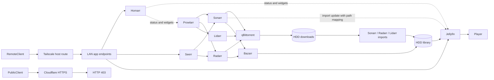

# Architecture and storage

[Documentation home](README.md) · [Resources](resources.md) · [Editable Draw.io diagram](homelab-architecture.drawio)

## Request and playback flow



SABnzbd is deployed with persistent state, but no Usenet account or active ARR download-client connection was configured for it. Bazarr has an English language profile, but cannot retrieve subtitles until providers are enabled. The diagram's Bazarr write path is the configured role, not evidence of completed subtitle downloads.

## Host storage

| Physical disk | Device at inspection | Filesystem/mount | Use |
| --- | --- | --- | --- |
| Intel SSD, 128 GB nominal | `/dev/sdb2` | ext4 `/` | Ubuntu, Docker images/writable layers, `/opt/media-stack/config`, Jellyfin cache |
| HGST HDD, 1 TB nominal | `/dev/sda` | Whole-device ext4 `/srv/media` | All downloads and final media libraries |
| WD Blue SN570 NVMe, 500 GB nominal | `/dev/nvme0n1` | Whole-device ext4 `/srv/ssd` | Jellyfin temporary streaming segments |

The Ansible defaults identify the two data disks by `/dev/disk/by-id` serial paths. `/etc/fstab` mounts their filesystem UUIDs, so Linux device renumbering does not change the target. The operating-system disk is not an initialization target. Filesystems use `noatime`; data-disk ext4 initialization used zero reserved-block percentage.

```text
/opt/media-stack/                 # boot SSD
  compose.yml
  config/<app>/                  # databases, settings, metadata
  cache/jellyfin/                 # general Jellyfin cache
  admin-credentials.json          # private; do not commit
  .homarr.env                    # private encryption key; do not commit
  .configured-*                  # first-run completion markers
/srv/media/                      # HDD
  downloads/torrents/
    incomplete/
    tv/ movies/ music/
  downloads/usenet/
    incomplete/ complete/
  library/
    tv/ movies/ music/
/srv/ssd/                        # NVMe
  jellyfin/transcodes/            # disposable streaming segments
```

The category subdirectories are prepared, but live qBittorrent transfers were observed saving to `/data/downloads/torrents`, not necessarily the category subdirectories. Both locations map to the same HDD. Changing a category alone does not guarantee that an existing torrent moves.

## Container paths and permissions

Sonarr, Radarr, Lidarr, Bazarr, qBittorrent and SABnzbd each receive one common bind mount: `/srv/media` on the host becomes `/data` in the container. This preserves a single filesystem boundary for downloads and libraries. Sonarr's hardlink test passed as UID/GID `1000:1000`; completed downloads can be linked into the library without a second complete media copy. Directory ownership is UID/GID 1000 and mode `2775`; LinuxServer images use `UMASK=002`.

Jellyfin mounts the read-only HDD libraries, writable config and cache on the boot SSD, and the dedicated transcode directory on the NVMe. Homarr, Seerr and Prowlarr do not mount the HDD library. Persistent media-app state is a bind mount under `/opt/media-stack/config`.

Uptime Kuma has its own Compose project and boot-SSD data directory `/opt/uptime-kuma/data`. It reaches the media apps through their existing LAN endpoints; it has no media mount or Docker socket. The official Hermes container uses its own project at `/opt/hermes`, maps its runtime user to UID/GID 1000, and stores state in `/opt/hermes/data`. Linux host networking supports its bearer-protected API on loopback `8642` and SSH-forwarded login callbacks. It has no host-home, media or Docker-socket mount. It uses the ChatGPT/Codex provider after the user signs in. Neither addition uses the extra NVMe or receives a GPU device.

## Startup and networking

Docker's service override at `/etc/systemd/system/docker.service.d/media-storage.conf` contains `RequiresMountsFor=/srv/media /srv/ssd`, `BindsTo=srv-media.mount srv-ssd.mount`, and ordering after both mounts. This applies to every Docker service on the laptop: Docker starts after storage is mounted and stops if either mount is deactivated. Data bind mounts in Compose use `create_host_path: false`.

Each service has `restart: unless-stopped` and JSON log rotation (`10m`, three files). The Compose project is `media-stack`; the shared default bridge network provides service-name DNS. Browser URLs use the host LAN IP. App-to-app URLs normally use `sonarr:8989`, `radarr:7878`, `prowlarr:9696`, `qbittorrent:8080`, etc. Homarr's integration URLs currently use the LAN IP so the generated app links also work in a browser.

Web ports bind specifically to `192.168.1.243`. The qBittorrent image exposes peer port 6881 internally, but Compose does not publish it on the host. The host Tailscale service advertises only `192.168.1.243/32`, so private clients can reuse the LAN-bound app links without router port forwarding. The [Tailscale guide](tailscale.md) covers the route, policy and validation. The [Cloudflare public hostname](public-access.md) currently returns HTTP 403.

## Hardware acceleration

Only Jellyfin receives `/dev/dri/renderD128`, the Intel i915 render device, with the device's host group added. VA-API hardware encoding is enabled and a synthetic H.264 encode passed. The NVIDIA GTX 1060 Mobile is not assigned to the stack; an NVIDIA container runtime was not installed by this role. The setup has not established real-client playback quality, concurrent-stream capacity or GPU load under sustained transcoding.
