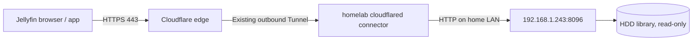

# Public Jellyfin access through Cloudflare Tunnel

[Documentation home](README.md) · [Jellyfin guide](apps/jellyfin.md) · [Cloudflare state](../../cloudflare/jellyfin-public.json)

Hostname: **[https://jellyfin.surajkamath.dev](https://jellyfin.surajkamath.dev)**. **Currently blocked with HTTP `403` pending an access-mode decision.** DNS, the tunnel and cache rule are configured. Cloudflare Access/SSO has not been added.

Validation found that Jellyfin's direct video endpoint returns media without credentials, including when given an invalid token. This matches [Jellyfin issue #13984](https://github.com/jellyfin/jellyfin/issues/13984). The normal account login protects user/library APIs, but does not protect every media route. The public origin route was therefore replaced with a hostname-scoped `http_status:403` response. LAN Jellyfin and ongoing playback are available.

Pending choice: add a Cloudflare Access login gate for browser access (native TV/mobile clients may be incompatible), or explicitly accept standard public Jellyfin's direct-video-URL limitation for native clients. Do not restore the origin ingress without resolving that choice.

## Traffic path



The existing `homelab` remotely managed tunnel was healthy before this change. Its connector reports Linux amd64 and cloudflared `2026.11.1`. The Alienware currently runs the enabled and active `cloudflared-homelab.service` under `argus`, with user lingering enabled. No new cloudflared installation, tunnel token, container or host service was needed, and the existing tunnel was not deleted/replaced. A healthy connector and a reachable Alienware are both required for the public service.

## Cloudflare configuration

| Resource | Current setting |
| --- | --- |
| Zone | `surajkamath.dev` |
| Tunnel | `homelab`, `43ef4de5-6b0c-459e-b36a-f9e9eb135a41` |
| Published hostname | `jellyfin.surajkamath.dev` |
| Current hostname service | `http_status:403` (config version 2) |
| Prepared origin | `http://192.168.1.243:8096` |
| Origin Host header | `jellyfin.surajkamath.dev` |
| Last ingress rule | `http_status:404` catch-all |
| DNS | Proxied CNAME to `43ef4de5-6b0c-459e-b36a-f9e9eb135a41.cfargotunnel.com`, automatic TTL |
| Cache rule | `jellyfin_no_cache`: bypass cache only when `http.host` is this hostname |

The tunnel had no published-hostname configuration and no conflicting DNS record existed at inspection. A hostname-scoped cache rule was added to a new zone cache-settings entrypoint; it does not disable caching for other hosts.

Current and prepared state is recorded without credentials in:

- [`cloudflare/jellyfin-public.json`](../../cloudflare/jellyfin-public.json): account/zone/resource IDs and settings.
- [`cloudflare/jellyfin-ingress.json`](../../cloudflare/jellyfin-ingress.json): currently applied blocked ingress array.
- [`cloudflare/jellyfin-origin-ingress.json`](../../cloudflare/jellyfin-origin-ingress.json): prepared origin route, not currently applied.
- [`cloudflare/jellyfin-cache-rules.json`](../../cloudflare/jellyfin-cache-rules.json): cache rule array.

The manifest distinguishes applied blocked ingress from prepared origin ingress. Apply the files manually through Cloudflare after reviewing the target and access settings. Cloudflare control-plane changes were made through the `cf` CLI, using the authenticated desktop profile. The preinstalled CLI was `0.15.0`; current command discovery/schema support was used through `npx --yes cf@1.0.0-rc.2`, without replacing the global CLI.

For review or a later change, use supported Node.js for the selected CLI version, inspect current resources, and preserve rules/routes added by other work:

```bash
# Run from the repository root on a machine authenticated with cf.
export CLOUDFLARE_ACCOUNT_ID=c4b21094b9a8b7be76a37dad03a3b7c8
npx --yes cf@1.0.0-rc.2 tunnels config get 43ef4de5-6b0c-459e-b36a-f9e9eb135a41
npx --yes cf@1.0.0-rc.2 dns records list --zone surajkamath.dev --name jellyfin.surajkamath.dev
npx --yes cf@1.0.0-rc.2 rulesets entrypoint get http_request_cache_settings --zone surajkamath.dev

# Preview the recorded ingress. Do not overwrite newer routes with this snapshot.
npx --yes cf@1.0.0-rc.2 tunnels config update \
  43ef4de5-6b0c-459e-b36a-f9e9eb135a41 \
  --tunnel-config-ingress @cloudflare/jellyfin-ingress.json --dry-run
```

The Tunnel and DNS records already exist. Do not blindly run create commands again. Retrieve `cf schema` and a dry run before updating a resource. Tunnel credentials/API tokens are not stored in the repo or installed on the Alienware by this task.

## Jellyfin settings

Jellyfin's global remote access is enabled; its administrator already allowed remote access. The origin connection was observed as `192.168.1.243`, and that exact address was added to Known Proxies, preserving other network fields. The previous network settings were backed up privately on the host at `/opt/media-stack/jellyfin-network-before-tunnel.json`.

The inventory opts in explicitly with `media_public_hostname: jellyfin.surajkamath.dev` and `media_jellyfin_known_proxies: [192.168.1.243]`. The role's [`configure-jellyfin-public.py`](../../ansible/roles/media_server/files/configure-jellyfin-public.py) enables remote access and adds the supplied exact proxy IPs through the authenticated local Jellyfin API. It preserves other proxy entries and only reports sanitized settings. An existing-config run returned `changed: false` after readback. An empty default hostname skips this task on hosts that have not opted in.

This helper configures Jellyfin; it does not provision a Cloudflare connector or apply DNS. Jellyfin still listens on its existing LAN HTTP endpoint; Cloudflare terminates public HTTPS. No inbound router ports or local HTTPS certificate were added.

The session API continued reporting the origin address during public tests. True external-client IP attribution was not independently established, despite the saved Known Proxies setting. Review forwarded-IP behavior before relying on per-client network/bitrate restrictions. Jellyfin reported no pending restart; one active playback session was detected, so no restart was forced during publication.

## Validation performed

- Public HTTPS served Jellyfin's UI/API with certificate verification enabled.
- Public login with the existing Jellyfin account succeeded, and the API listed the available episodes.
- The user endpoint without credentials returned `401`.
- A direct video URL without credentials returned `206`; local requests with invalid header/query tokens also returned `206`.
- After blocking the route, the public endpoint returned `403`.
- An authenticated 1 KiB video byte-range request returned `206` and a valid Content-Range.
- An authenticated WebSocket handshake returned `101`.
- The hostname cache rule was read back and the tested media response was not served from cache (`CF-Cache-Status: DYNAMIC`).

The earlier tests established transport and account login, but the final test failed the media-authentication check. Public access is therefore not complete. They are not a sustained remote-playback or bandwidth benchmark. Tests traversed the public Cloudflare hostname; no separate cellular-client playback session was performed. A default Python urllib user agent received Cloudflare error `1010`; explicit Jellyfin-client headers passed. Distinguish an edge rejection from Jellyfin credentials when testing with scripts.

## Rollback

1. Read the tunnel's latest configuration and remove only the `jellyfin.surajkamath.dev` ingress entry. Retain other routes and a final 404 catch-all. Do not delete the shared `homelab` tunnel.
2. Remove only this hostname's DNS record (ID is in the state manifest). Removing DNS alone does not remove the published route.
3. Remove only cache rule ref `jellyfin_no_cache`, preserving other rules now present in the zone entrypoint.
4. Review Jellyfin's current network configuration alongside the private pre-change backup. Revert only the remote-access/proxy fields introduced here if no remaining public route needs them; do not overwrite unrelated newer settings.
5. Remove/clear the inventory's public-hostname opt-in before rerunning Ansible, otherwise its helper will re-enable the desired public-proxy settings.

The LAN Jellyfin URL and HDD media are independent of the public DNS/tunnel route.

## References

- [Cloudflare Tunnel setup and published applications](https://developers.cloudflare.com/tunnel/get-started/)
- [Jellyfin reverse-proxy settings](https://jellyfin.org/docs/general/post-install/networking/reverse-proxy/)

## Connector on the Alienware

The remotely managed tunnel runs under `argus` as
`cloudflared-homelab.service`. Check its status and recent messages over SSH:

```bash
ssh alienware 'systemctl --user status cloudflared-homelab.service --no-pager'
ssh alienware 'journalctl --user -u cloudflared-homelab.service -n 30 --no-pager'
```

On a rebuild, use the existing remotely managed tunnel's connector enrollment
command to obtain its install token. Store the token in a private systemd user
environment file on the Alienware, enable the connector service and enable
lingering for `argus` so it can run before login. Keep the token on the host.
Verify the connector and Jellyfin's ingress independently.
